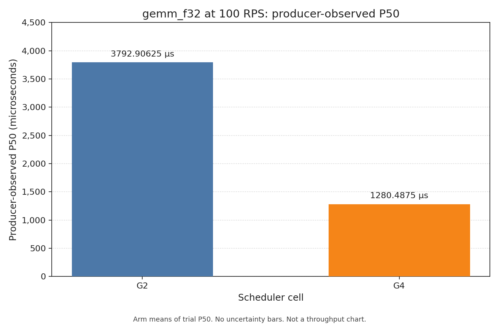
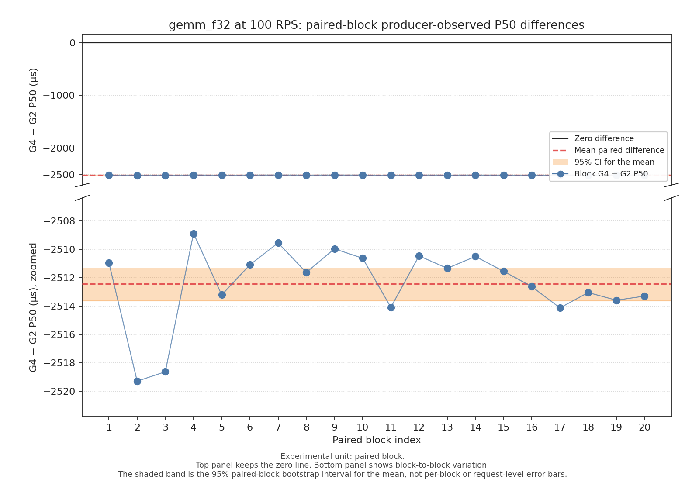

# Arrival-aware sparse GEMM benchmark: G4 versus G2

Authorized documentation release of one independently audited paired
study of arrival-aware batching on InferEdge's neural scheduler path
under sparse GEMM traffic.

Machine-readable companion:
[`arrival-aware-sparse-gemm-results.json`](arrival-aware-sparse-gemm-results.json).

Figures:

- [`arrival-aware-sparse-gemm-p50.png`](arrival-aware-sparse-gemm-p50.png)
- [`arrival-aware-sparse-gemm-paired-deltas.png`](arrival-aware-sparse-gemm-paired-deltas.png)

This document is a reviewed aggregate extract. It is not a dump of raw
trial stdout/stderr. The local raw run directory used as source evidence
is **not** published on GitHub and is not automatically available to
external readers.

Public results format version **1** in the companion JSON is distinct from
runner report schema version **3** and analysis protocol version **2**.

## 1. Executive summary

Under a frozen 100 RPS open-loop `gemm_f32` workload on one Darwin arm64
host, cell **G4** (arrival-aware EWMA batching, max batch 4, delay 2 ms)
showed lower producer-observed P50 than fixed-delay cell **G2** (same cap
and delay, arrival-aware off). The mean paired difference
(`P50_G4 − P50_G2`) was **−2512.41875 µs** (95% CI
**[−2513.64165, −2511.35629875] µs**, 20 paired blocks, seed `20261016`,
10 000 replicates).

Sparse traffic produced almost exclusively size-one batches. This study
does **not** demonstrate larger G4 batches. Successful throughput stayed
near the frozen offered rate on both arms (~100.130/s vs ~100.139/s).
That is not a throughput gain. No winner or universal scheduler ranking
is declared.

The ratio of observed P50 arm means is **2.962** (`3792.90625 / 1280.4875`).
That figure is a ratio of producer-observed P50 values under this
workload. It is not a generic 3× speedup headline and not a throughput
ratio.

## 2. Question being tested

For this specific frozen contrast, does arrival-aware early sealing (G4)
change producer-observed P50 latency relative to fixed-delay configured
batching (G2) at 100 RPS on `gemm_f32`?

Contrast id: `gemm_f32_G2_vs_G4_sparse_rps100`

Sign convention: `G4_minus_G2` (`P50_G4 - P50_G2`)

Primary endpoint: `successful_e2e_latency.p50_microseconds`

## 3. Model and configurations

| Item | Value |
|------|-------|
| Model | `gemm_f32` (features `[batch,512]` → product `[batch,512]`) |
| Workload | `open_loop_constant` |
| Offered rate | 100 RPS (frozen) |
| Duration / warmup | 5000 ms / 100 requests |
| Workers / queue | 1 / 64 |
| Schema / protocol | report schema 3 / analysis protocol 2 |
| Completion timing | OFF (schema 4 instrumentation not enabled) |
| Batch-decision instrumentation | OFF |
| Reference policy | `precomputed_reference_compare` |
| Observation quantum | 1 ms open-loop producer completion poll |

| Cell | Batching | Max batch size | Max delay | Adaptive | Arrival-aware |
|------|----------|----------------|-----------|----------|---------------|
| G2 (baseline) | enabled | 4 | 2 ms | false | false |
| G4 (alternative) | enabled | 4 | 2 ms | false | true |

Each counted trial recorded six cell-definition identity keys:
`id`, `enable_batching`, `max_batch_size`, `max_batch_delay_ms`,
`adaptive_batching`, and `arrival_aware_batching`. G4 runner argv equals
G2 argv plus `--arrival-aware-batching`.

## 4. Mechanism

**G2** uses fixed-delay batching. It may wait up to 2 ms (or until the
batch cap of 4) before sealing.

**G4** uses arrival-aware EWMA (alpha 1/8 in the current binary) with the
same cap and delay. It may seal before the deadline when the expected
interarrival exceeds remaining wait.

A separate prior instrumented calibration is supporting mechanism context
only. Its traces are **not** contemporaneous paired evidence from this
campaign. Schema-3 batch histograms in this study do **not** identify
seal reasons.

## 5. Environment and artifacts

| Field | Value |
|-------|-------|
| Tooling / collection Git commit | `d21da8ee5095b9c8cec8c7d48d0ee9e607b58d08` |
| Host | Darwin arm64, hardware model Mac17,8 |
| Compiler | AppleClang 21.0.0 (`Apple clang version 21.0.0 (clang-2100.3.34.2)`) |
| ONNX Runtime | 1.31.0 CPU |
| Build | Release |
| Executable SHA-256 | `6ef6294ba6f10f7519ad1020d2277272e15deb8578c2880b82f9bc3d024e39d5` |
| ONNX SHA-256 | `a6203020b870eb04f9fd8e836cf4ccd930a57156a026d2a50163121d83debf32` |
| Sidecar SHA-256 | `a335c8b12defcb885f8bada9ef1092655d024d5586fe011a9336ad2d472f82b6` |

Campaign metadata records the collection-time repository commit and the
executable SHA-256. It does **not** record a separate compile-time
binary-source commit. This report does not substitute tooling HEAD for an
unrecorded binary-source commit. A rebuilt binary may have a different
SHA-256.

Source evidence identifier (local, unpublished):
`neural-gemm-f32-20261015T082639Z-d21da8e`.

## 6. Measurement methodology

- Primary metric: producer-observed P50 successful end-to-end latency
  (`steady_clock` immediately before `submit()` until the future is
  observed ready).
- This endpoint includes completion-observation delay, including the 1 ms
  open-loop observation quantum. It is **not** pure model inference
  latency.
- Experimental unit: one paired block (one G2 trial and one G4 trial).
- Design: two uncounted pilots (G2 then G4), then 20 counted blocks with
  within-profile cyclic rotation (block 1: G2 then G4; block 2: G4 then
  G2; alternate thereafter).
- Statistics: paired-block bootstrap mean of `G4 − G2` differences;
  10 000 replicates; seed `20261016`; 95% percentile interval with linear
  interpolation. All 20 counted blocks are required.
- Requests are not resampled as independent experimental units.
- Pilots are excluded from statistics.

## 7. Trial validity

| Check | Result |
|-------|--------|
| Total trials / pilots / counted trials / blocks | 42 / 2 / 40 / 20 |
| Counted successful requests | 20 000 (10 000 per arm) |
| Correctness mismatches | 0 |
| Generator skips | 0 |
| Admission rejections | 0 |
| Inference / scheduler / worker failures | 0 |
| Timeouts / cancellations | 0 |
| Delivery class (all counted trials) | `STRICT_PRIMARY` |
| Retries / selective exclusions | none |
| Six-key identity (all counted trials) | G2 arrival-aware false; G4 arrival-aware true |
| Arrival-screen max lag ≤ 5 000 000 ns | 3 counted misses; screen is non-gating |

## 8. Primary statistical finding

| Quantity | Value |
|----------|-------|
| G2 P50 mean across 20 blocks | 3792.90625 µs |
| G4 P50 mean across 20 blocks | 1280.4875 µs |
| Mean paired effect (G4 − G2) | **−2512.41875 µs** |
| 95% CI | **[−2513.64165, −2511.35629875] µs** |
| Bootstrap | `paired_block_bootstrap_mean`, seed `20261016`, 10 000 replicates |
| Experimental unit | paired block |

The interval excludes zero under this protocol. That supports a
directional paired difference **for this host, binary, model, and sparse
100 RPS contrast only**. It does **not** authorize a universal scheduler
superiority claim.

Reconciled block-level `G4 − G2` P50 differences (microseconds), verified
against the authorized runner JSON reports:

`-2510.958, -2519.291, -2518.625, -2508.875, -2513.209, -2511.084,
-2509.542, -2511.625, -2509.958, -2510.625, -2514.083, -2510.458,
-2511.333, -2510.500, -2511.542, -2512.625, -2514.125, -2513.042,
-2513.583, -2513.292`

Per-block P50 pairs and additional trial fields are listed in
[`arrival-aware-sparse-gemm-results.json`](arrival-aware-sparse-gemm-results.json)
under `paired_blocks`.



Chart 1 shows G2 and G4 mean trial P50 in microseconds. It does not show
throughput and does not draw uncertainty bars from the paired-effect CI
on the arm means.



Chart 2 shows the 20 block-level G4-minus-G2 differences, a zero-difference
line, the mean paired difference, and the 95% paired-block bootstrap
interval for that mean. The experimental unit is the paired block. There
are no request-level error bars. The top panel keeps the zero line; the
bottom panel zooms to block-to-block variation so the mean interval is
visible.

## 9. Secondary observations

| Metric | G2 mean | G4 mean |
|--------|---------|---------|
| Producer-observed P95 | 3829.5606 µs | 1299.7228 µs |
| Producer-observed P99 | 3901.7834 µs | 1361.5250 µs |
| Successful throughput | 100.130244… /s | 100.139262… /s |
| Mean realized batch size | 1.000100010001 | 1.0 |
| Engine runs (counted) | 9999 | 10000 |

Successful throughput remains near the frozen 100 RPS offer. Do not claim
a throughput gain.

## 10. Actual batch-formation evidence

Mean realized batch size is `sum(size × count) / sum(count)` for
`size ≥ 1`.

Counted G2 histogram: size 1 × 9998, size 2 × 1; 9999 engine runs; mean
batch size ≈ 1.0001. The single size-2 engine run was in G2 block 14.

Counted G4 histogram: size 1 × 10000; 10000 engine runs; mean batch size
1.0.

Sparse 100 RPS traffic with a 2 ms delay cap produced almost exclusively
size-one batches. This study does **not** demonstrate larger G4 batches.

## 11. Arrival-fidelity limitations

`arrival_fidelity_status = not_certified`.
`phase_boundary_fidelity = unavailable`.

The coarse `coarse_max_lag_v1` screen is an inclusive maximum generator-lag
bound of 5 000 000 ns. It is **not** an arrival certificate. The screen
was non-gating in this campaign.

Three counted misses:

| Cell | Block | Trial | `generator_lag.maximum_nanoseconds` |
|------|-------|-------|-------------------------------------|
| G2 | 14 | `G2-neural_open-14` | 9 625 458 |
| G4 | 16 | `G4-neural_open-16` | 5 777 584 |
| G2 | 18 | `G2-neural_open-18` | 5 722 583 |

Producer-observed latency also includes the 1 ms completion-observation
quantum. Isolated queue-wait reduction is not recoverable from schema-3
evidence.

## 12. Limitations

- Arrival fidelity was not certified.
- Completion timing and batch-decision instrumentation were **OFF**.
  Counted trials are schema 3. Schema-4 completion timing was not
  enabled, and batch-decision seal reasons were not recorded.
- No historical trials served as controls. Prior A/G2 and A/G2/G3
  publications are not paired controls for this contrast and are not
  combined into this estimate.
- The 5 ms max-lag screen is a coarse lateness bound, not precise
  scheduling certification.
- Producer-observed latency includes observation delay.
- Queue waiting was not separately instrumented.
- Sparse traffic produced almost exclusively size-one batches.
- G4 seal reasons cannot be inferred from schema-3 histograms.
- Prior instrumented calibration is not contemporaneous paired evidence.
- One Apple Silicon host only.
- CPU GEMM (`gemm_f32`) on ONNX Runtime 1.31.0 CPU, not a GPU or
  production LLM workload.
- Only this frozen 100 RPS G2/G4 contrast was evaluated in the paired
  study.
- Do not generalize to saturation, other models, or other hosts.
- The untracked local raw run set has not been published or archived as
  public evidence.
- Bootstrap bit-identity is not promised across all software environments.

## 13. Reproduction

Released tooling commit:
[`d21da8ee5095b9c8cec8c7d48d0ee9e607b58d08`](https://github.com/KasaVarun/inferedge/commit/d21da8ee5095b9c8cec8c7d48d0ee9e607b58d08).

Frozen collector command used for this campaign (Release
`inferedge-bench-scheduler` identified by the SHA-256 above):

```bash
python3 -m benchmarks.collect_neural_scheduler \
  --binary build-batch-decision-g2c/inferedge-bench-scheduler \
  --repo-root /Users/varunkasa/InferEdge/InferEdge \
  --expected-commit d21da8ee5095b9c8cec8c7d48d0ee9e607b58d08 \
  --mode reportable \
  --model-id gemm_f32 \
  --cells G2,G4 \
  --baseline-cell G2 \
  --alternative-cell G4 \
  --target-rps 100 \
  --duration-ms 5000 \
  --counted-runs 20 \
  --offered-rate-frozen
```

Analyzer:

```bash
python3 -m benchmarks.analyze_neural_scheduler \
  benchmarks/scheduler_runs/neural-gemm-f32-20261015T082639Z-d21da8e
```

Notes:

- The recorded executable SHA-256 identifies the binary used for this
  campaign. A rebuilt binary must be identified separately.
- Different hosts may produce different latency magnitudes.
- Do not expect bit-identical timing across machines.
- The local untracked run directory is not automatically available to
  external readers. This report does not claim public reproducibility from
  a raw run set that has not been published or archived.
- Model regeneration, if needed, follows the repository's pinned
  `onnx==1.22.0` generators and hash pins; normal reproduction should use
  the committed ONNX and sidecar artifacts.

Expected inventory for a successful reportable campaign: 2 pilots +
40 counted trials (20 paired blocks), schema 3, protocol 2, STRICT_PRIMARY
delivery, zero correctness mismatches, six-key G2/G4 identity, and
bootstrap seed `20261016`. The coarse arrival screen is non-gating.

## Claim policy

Allowed: under these tested conditions, G4 showed lower producer-observed
P50 than G2; the paired 95% CI for the mean difference excludes zero; a
P50 ratio, if shown, is a ratio of observed P50 values; throughput was
similar at the frozen offered rate; batching remained almost entirely
size one.

Not claimed: universal scheduler superiority; guaranteed speedup; GPU
optimization; LLM speedup; throughput increase; certified arrival
fidelity; isolated queue-wait reduction from schema-3 evidence; larger
G4 batches; a generic 3× speedup headline.

`winner_declared = false`

`superiority_claimed = false`
